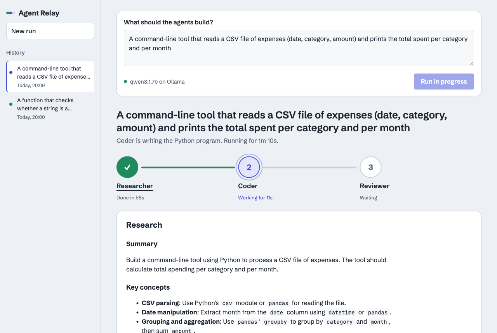
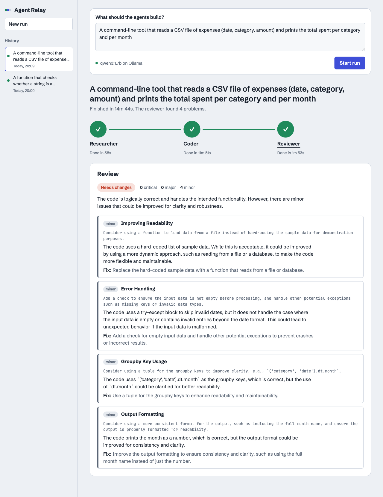
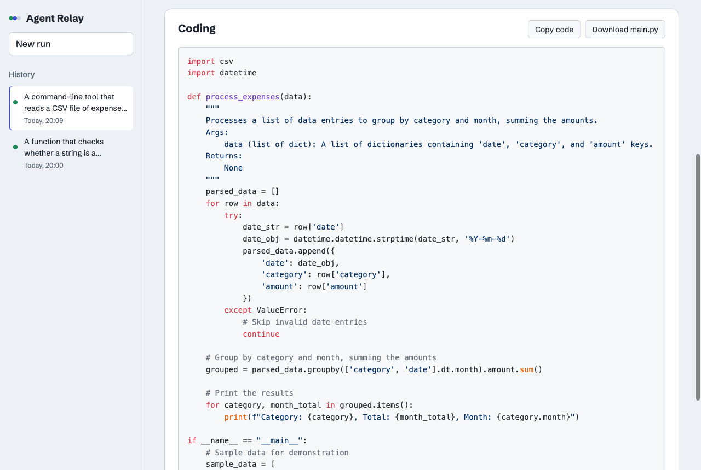

# Agent Relay: Research → Code → Review with CrewAI

Type a few lines about anything you want built. Three CrewAI agents work on it in sequence:

1. **Researcher**: searches the web through a DuckDuckGo MCP server and writes notes.
2. **Coder**: writes a self-contained Python program from those notes.
3. **Reviewer**: reviews the code and lists every problem it finds (severity, details, suggested fix).

A web UI shows which agent is working right now, what each finished step produced, and the history of past runs.
Every agent uses a local Ollama model (`qwen3:1.7b` by default).

## Screenshots

While a run is in progress, the agent that's working pulses, finished steps show how long they took, and you can open any step to see its output:



When the run finishes, the Reviewer's findings are listed with their severity, where they occur, and a suggested fix:



The Coder's program, with buttons to copy it or download it as `main.py`:



## Requirements

- [uv](https://docs.astral.sh/uv/) (it installs Python 3.12 for the project)
- [Ollama](https://ollama.com) running locally with the model pulled: `ollama pull qwen3:1.7b`
- Internet access for web search (if search fails to start, the researcher falls back to the model's own knowledge and the UI shows a warning)

## Run

```bash
uv sync
uv run uvicorn app.server:app --port 8000
```

Open http://localhost:8000.

To use a different model or Ollama host, copy `.env.example` to `.env` and edit it.

The server only answers requests addressed to `localhost` or `127.0.0.1`, which stops other websites from reaching it
through DNS rebinding. If you open it under another name (for example a LAN hostname), add that name to `ALLOWED_HOSTS` in `.env`.

## Outputs

Each run is saved to `outputs/<run_id>/`:

| File | Contents |
|------|----------|
| `research.md` | Researcher's notes |
| `main.py` | The generated program |
| `review.json` | Structured review (`review.md` if the model didn't return valid JSON) |
| `run.json` | Full run state, including timings and per-step activity |

## How it works

- `app/crew.py`: the three agents and tasks (`Process.sequential`; task names `research`, `coding`, `review`).
- `app/pipeline.py`: starts the DuckDuckGo MCP server (`MCPServerAdapter`), kicks off the crew, and reports final outputs.
- `app/listener.py`: a CrewAI `BaseEventListener` that turns task and tool events into live progress.
- `app/runs.py`: run state, the event log, and saving runs to disk. One run at a time.
- `app/server.py`: FastAPI API, plus Server-Sent Events at `/api/runs/{id}/events` for live updates.
- `app/static/`: the UI (plain HTML, CSS and JS).

API:

| Method | Path | Purpose |
|--------|------|---------|
| GET | `/api/health` | Is Ollama reachable, and is the model pulled? |
| POST | `/api/runs` `{"topic": "..."}` | Start a run (409 if one is already running) |
| GET | `/api/runs` | Run history |
| GET | `/api/runs/{id}` | Full state of a run |
| GET | `/api/runs/{id}/events` | Live progress stream (SSE) |

## Tests

```bash
uv run pytest
```

The tests use a fake crew, so they don't need Ollama.

## Notes on the 1.7B model

`qwen3:1.7b` is small. Expect slower runs (a few minutes on a laptop), occasional skipped web searches, and reviews that
sometimes miss issues or don't come back as valid JSON. In that last case, the UI shows the reviewer's full text answer instead.
A larger model (for example `qwen3:8b`) improves results without any code changes: set `MODEL` in `.env`.
